<div align="right">
  
</div>

<p align="center">
  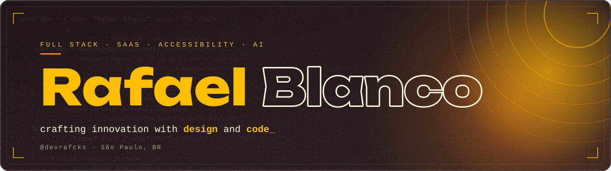
</p>

<p align="center">
  
</p>



[](https://git.io/typing-svg)

Full Stack developer from São Paulo, Brazil. I build SaaS and digital products end to end: requirements, architecture, database, payments, deploy and everything after it goes live. Accessibility and performance go in the first commit.

I'm the creator of **SeeB**, an open-source accessibility widget that was born as my final project at ETEC, and I build my own SaaS products, like **Carretel**. I hold a technical degree in **Internet Informatics** (ETEC) and I'm studying **Software Engineering** (Gran Faculdade) and **AI & Digital Automation** (UniFECAF).

> *"People's dreams never end."* – Marshall D. Teach

```diff
+ Building SaaS and products end to end: Next.js, React Native, Node.js and PostgreSQL
+ Accessibility and performance from the first commit (SeeB)
+ AI agents and MCP in the daily workflow
+ Open to opportunities and collaborations
- Bugs (working on it)
```

<br clear="right"/>
<br/>


### Design & Prototyping

<p>
  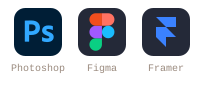
</p>

### Front-End & Mobile

<p>
  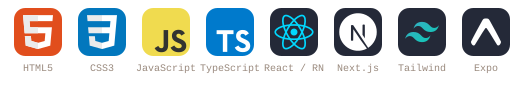
</p>

### Back-End & Databases

<p>
  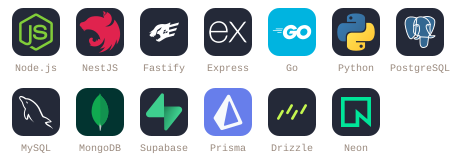
</p>

### AI & Analytics

<p>
  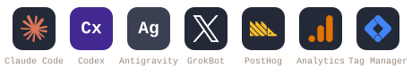
</p>

### Payment Gateways

<p>
  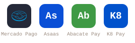
</p>

### DevOps & Infrastructure

<p>
  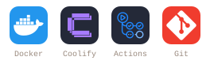
</p>

### Testing & Quality

<p>
  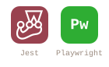
</p>

### Platforms & Hosting

<p>
  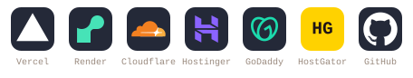
</p>

### Other Skills

<p>
  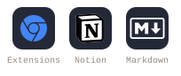
</p>

<br/>


<p align="center">
  <picture><source media="(prefers-color-scheme: dark)" srcset="https://raw.githubusercontent.com/devrafcks/devrafcks/output/stats-dark.svg" /><source media="(prefers-color-scheme: light)" srcset="https://raw.githubusercontent.com/devrafcks/devrafcks/output/stats.svg" /></picture>
  <picture><source media="(prefers-color-scheme: dark)" srcset="https://raw.githubusercontent.com/devrafcks/devrafcks/output/langs-dark.svg" /><source media="(prefers-color-scheme: light)" srcset="https://raw.githubusercontent.com/devrafcks/devrafcks/output/langs.svg" /></picture>
</p>
<p align="center">
  <picture><source media="(prefers-color-scheme: dark)" srcset="https://raw.githubusercontent.com/devrafcks/devrafcks/output/impact-dark.svg" /><source media="(prefers-color-scheme: light)" srcset="https://raw.githubusercontent.com/devrafcks/devrafcks/output/impact.svg" /></picture>
  <picture><source media="(prefers-color-scheme: dark)" srcset="https://raw.githubusercontent.com/devrafcks/devrafcks/output/streaks-dark.svg" /><source media="(prefers-color-scheme: light)" srcset="https://raw.githubusercontent.com/devrafcks/devrafcks/output/streaks.svg" /></picture>
</p>
<p align="center">
  <picture><source media="(prefers-color-scheme: dark)" srcset="https://raw.githubusercontent.com/devrafcks/devrafcks/output/weekdays-dark.svg" /><source media="(prefers-color-scheme: light)" srcset="https://raw.githubusercontent.com/devrafcks/devrafcks/output/weekdays.svg" /></picture>
  <picture><source media="(prefers-color-scheme: dark)" srcset="https://raw.githubusercontent.com/devrafcks/devrafcks/output/months-dark.svg" /><source media="(prefers-color-scheme: light)" srcset="https://raw.githubusercontent.com/devrafcks/devrafcks/output/months.svg" /></picture>
</p>

<br/>


<picture>
  <source media="(prefers-color-scheme: dark)" srcset="https://raw.githubusercontent.com/devrafcks/devrafcks/output/code-contribution-graph-dark.svg" />
  <source media="(prefers-color-scheme: light)" srcset="https://raw.githubusercontent.com/devrafcks/devrafcks/output/code-contribution-graph.svg" />
  
</picture>

<br/>
<br/>


<p align="center">
  Got a product to ship or a system that needs someone end to end?<br/>
  Let's build something.
</p>

<p align="center">
  <a href="https://rafaelblanco.vercel.app/"></a>
</p>
<p align="center">
  <a href="https://www.linkedin.com/in/rafael-henrique-blanco-0455b12a6/"></a><a href="https://github.com/devrafcks"></a><a href="https://devrafcks.github.io/Linkbio/"></a><a href="mailto:rafcksps@gmail.com"></a>
</p>

<p align="center">
  
</p>
